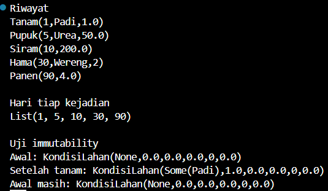

# ****Taninote: Sistem Pencatatan Riwayat Lahan Berbasis Event****

---

### Permasalahan Utama

Petani sering lupa atau salah mencatat apa yang sudah terjadi di lahannya, seperti kapan terakhir dipupuk, berapa kali disiram, kapan panen, dan kenapa hasil panen turun. Catatan yang ditimpa-timpa (misalnya “stok pupuk: 50 → 30”) membuat riwayat hilang, sehingga kesalahan tidak bisa ditelusuri.

Solusi dari kami, jangan simpan kondisi lahan, simpan kejadiannya. Kondisi lahan hari ini didapat dengan menjumlahkan semua kejadian dari awal. Dari solusi ini pastinya menerapkan immutability.

### Cara Kerjanya

Ini simpelnya kayak buku tulis yang ga pernah dihapus atau coret2 isinya, hanya menambah baris baru di bawah.

### Fitur Menu Console

Taninote: Sistem Pencatatan Riwayat Lahan Berbasis Event

 1. Lihat seluruh riwayat kejadian
 2. Lihat kondisi lahan saat ini
 3. Lihat kondisi lahan pada hari tertentu
 4. Tambah kejadian baru
 5. Batalkan kejadian terakhir (undo)
 6. Cari kejadian berdasarkan jenis
 7. Laporan ringkasan musim tanam
 0. Keluar

Pilih menu:

>Kejadian yang didukung cukup 5 jenis, yaitu:
1. Tanam
2. Pupuk
3. Siram
4. Hama
5. Panen

---

### Struktur Data

Disini, bakal ada dua struktur data dan keduanya immutable.

1. `Kejadian`: apa yang terjadi di lahan (ini bakal disimpan di riwayat)
2. `KondisiLahan`: keadaan lahan hasil menghitung kejadian

(1) Kejadian

- Tanam: hari, nama tanaman, luas (hektar)
- Pupuk: hari, jenis pupuk, jumlah (kg)
- Siram: hari, jumlah air (liter)
- Hama: hari, nama hama, tingkat serangan (1 sampai 3)
- Panen: hari, hasil(ton)

>Kalau ada yang nanya kenapa semua kejadian punya hari, jawabannya supaya nanti mudah mengurutkan dan memfilter berdasarkan hari, sehingga dibuat hari sebagai yang wajib ada di semua jenis kejadian.

(2) KondisiLahan

- tanaman -> String: tanaman yang sedang ditanam (None kalau lahan kosong)
- luasHa -> Double: luas lahan yang ditanami
- totalPupukKg -> Double: akumulasi pupuk
- tingkatHama -> Int: akumulasi serangan hama
- totalPanenTon -> Double: akumulasi hasil panen

>Lahan juga butuh keadaan awal, yaitu lahan kosong dengan semua angka 0 dan tanaman = None. Keadaan ini jadi titik mulai saat kejadian dihitung satu per satu. Nanti diletakkan di companion object dengan nama kosong.

Gambar di atas adalah hasil dari pengujian struktur datanya.