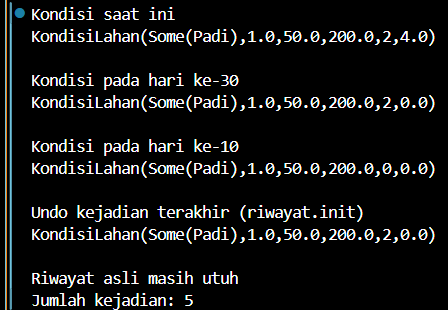
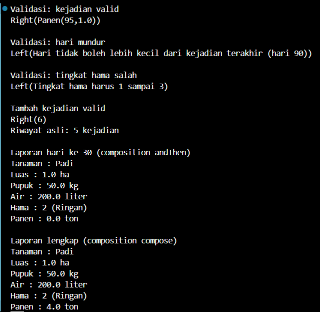
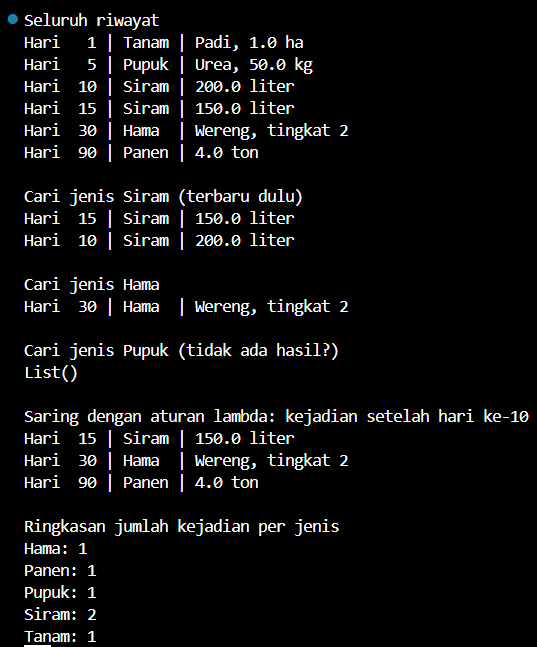

# ****Taninote: Sistem Pencatatan Riwayat Lahan Berbasis Event****

---

### Permasalahan Utama

Petani sering lupa atau salah mencatat apa yang sudah terjadi di lahannya, seperti kapan terakhir dipupuk, berapa kali disiram, kapan panen, dan kenapa hasil panen turun. Catatan yang ditimpa-timpa (misalnya “stok pupuk: 50 → 30”) membuat riwayat hilang, sehingga kesalahan tidak bisa ditelusuri.

Solusi dari kami, jangan simpan kondisi lahan, simpan kejadiannya. Kondisi lahan hari ini didapat dengan menjumlahkan semua kejadian dari awal. Dari solusi ini pastinya menerapkan immutability.

### Cara Kerjanya

Ini simpelnya kayak buku tulis yang ga pernah dihapus atau coret2 isinya, hanya menambah baris baru di bawah.

### Fitur Menu Console

Taninote: Sistem Pencatatan Riwayat Lahan Berbasis Event

 1. Lihat seluruh riwayat kejadian
 2. Lihat kondisi lahan saat ini
 3. Lihat kondisi lahan pada hari tertentu
 4. Tambah kejadian baru
 5. Batalkan kejadian terakhir (undo)
 6. Cari kejadian berdasarkan jenis
 7. Laporan ringkasan musim tanam
 0. Keluar

Pilih menu:

>Kejadian yang didukung cukup 5 jenis, yaitu:
1. Tanam
2. Pupuk
3. Siram
4. Hama
5. Panen

---

### Struktur Data

Disini, bakal ada dua struktur data dan keduanya immutable.

1. `Kejadian`: apa yang terjadi di lahan (ini bakal disimpan di riwayat)
2. `KondisiLahan`: keadaan lahan hasil menghitung kejadian

(1) Kejadian

- Tanam: hari, nama tanaman, luas (hektar)
- Pupuk: hari, jenis pupuk, jumlah (kg)
- Siram: hari, jumlah air (liter)
- Hama: hari, nama hama, tingkat serangan (1 sampai 3)
- Panen: hari, hasil(ton)

>Kalau ada yang nanya kenapa semua kejadian punya hari, jawabannya supaya nanti mudah mengurutkan dan memfilter berdasarkan hari, sehingga dibuat hari sebagai yang wajib ada di semua jenis kejadian.

(2) KondisiLahan

- tanaman -> Option[String]: tanaman yang sedang ditanam (None kalau lahan kosong)
- luasHa -> Double: luas lahan yang ditanami
- totalPupukKg -> Double: akumulasi pupuk
- totalAirLiter -> Double: akumulasi air
- tingkatHama -> Int: akumulasi serangan hama
- totalPanenTon -> Double: akumulasi hasil panen

>Lahan juga butuh keadaan awal, yaitu lahan kosong dengan semua angka 0 dan tanaman = None. Keadaan ini jadi titik mulai saat kejadian dihitung satu per satu. Nanti diletakkan di companion object dengan nama kosong.

Sebagai pengujian, kami menggunakan pembuktian dengan code di bawah untuk melihat struktur data bekerja dengan baik:

```scala
// Pengujian
@main def Taninote(): Unit =
  val riwayat: List[Kejadian] = List(
    Kejadian.Tanam(1, "Padi", 1.0),
    Kejadian.Pupuk(5, "Urea", 50.0),
    Kejadian.Siram(10, 200.0),
    Kejadian.Hama(30, "Wereng", 2),
    Kejadian.Panen(90, 4.0)
  )

  println("Riwayat")
  riwayat.foreach(println)

  println("\nHari tiap kejadian")
  println(riwayat.map(_.hariKe))

  println("\nUji immutability")
  val awal = KondisiLahan.kosong
  val setelahTanam = awal.copy(tanaman = Some("Padi"), luasHa = 1.0)
  println(s"Awal: $awal")
  println(s"Setelah tanam: $setelahTanam")
  println(s"Awal masih: $awal")
```


Gambar di atas adalah hasil dari pengujian struktur datanya.

### Fungsi Inti

- `terapkan`: satu lahan + satu kejadian -> lahan baru
- `replay`: menerapkan seluruh riwayat satu per satu
- `kondisiPadaHari`: kondisi lahan di hari tertentu

Dilanjut untuk menguji fungsi inti yang telah dibuat, kami mennggunakan code di bawah:

```scala
@main def Taninote(): Unit =
  val riwayat: List[Kejadian] = List(
    Kejadian.Tanam(1, "Padi", 1.0),
    Kejadian.Pupuk(5, "Urea", 50.0),
    Kejadian.Siram(10, 200.0),
    Kejadian.Hama(30, "Wereng", 2),
    Kejadian.Panen(90, 4.0)
  )

  println("Kondisi saat ini")
  println(kondisiSaatIni(riwayat))

  println("\nKondisi pada hari ke-30")
  println(kondisiPadaHari(riwayat, 30))

  println("\nKondisi pada hari ke-10")
  println(kondisiPadaHari(riwayat, 10))

  println("\nUndo kejadian terakhir (riwayat.init)")
  println(kondisiSaatIni(riwayat.init))

  println("\nRiwayat asli masih utuh")
  println(s"Jumlah kejadian: ${riwayat.length}")
```



Gambar di atas adalah hasil dari pengujian fungsi inti yang telah dibuat.

### Validasi dan Function Composition

- `validasi`: membuat fungsi pengecek kejadian dari riwayat yang ada
- `tambahKejadian`: riwayat + kejadian baru → riwayat baru (atau pesan error)
- `formatKondisi`: KondisiLahan -> teks laporan
- `laporanPadaHari`: saring -> hitung -> format, digabung

Seperti biasa, pengujian dilakukan dengan kumpulan code di bawah ini:

```scala
@main def Taninote(): Unit =
  val riwayat: List[Kejadian] = List(
    Kejadian.Tanam(1, "Padi", 1.0),
    Kejadian.Pupuk(5, "Urea", 50.0),
    Kejadian.Siram(10, 200.0),
    Kejadian.Hama(30, "Wereng", 2),
    Kejadian.Panen(90, 4.0)
  )

  println("Validasi: kejadian valid")
  println(validasi(riwayat)(Kejadian.Panen(95, 1.0)))

  println("\nValidasi: hari mundur")
  println(validasi(riwayat)(Kejadian.Siram(20, 100.0)))

  println("\nValidasi: tingkat hama salah")
  println(validasi(riwayat)(Kejadian.Hama(100, "Wereng", 5)))

  println("\nTambah kejadian valid")
  println(tambahKejadian(riwayat, Kejadian.Panen(95, 1.0)).map(_.length))
  println(s"Riwayat asli: ${riwayat.length} kejadian")

  println("\nLaporan hari ke-30 (composition andThen)")
  println(laporanPadaHari(30)(riwayat))

  println("\nLaporan lengkap (composition compose)")
  val laporanLengkap = formatKondisi compose hitung
  println(laporanLengkap(riwayat))
```



Gambar di atas adalah hasil pengujiannya.

### Chaining

Tahap ini memakai chaining, yaitu method berantai langsung pada data.

- `namaJenis`: kejadian -> nama jenisnya (string)
- `saring`: riwayat + aturan filter -> kejadian yang lolos
- `cariJenis`: cari kejadian berdasarkan jenis, urut hari terbaru
- `ringkasanJenis`: hitung jumlah kejadian tiap jenis
- `formatKejadian`: kejadian -> satu baris teks

Seperti biasa, pengujian dilakukan dengan kumpulan code di bawah ini:

```scala
@main def Taninote(): Unit =
  val riwayat: List[Kejadian] = List(
    Kejadian.Tanam(1, "Padi", 1.0),
    Kejadian.Pupuk(5, "Urea", 50.0),
    Kejadian.Siram(10, 200.0),
    Kejadian.Siram(15, 150.0),
    Kejadian.Hama(30, "Wereng", 2),
    Kejadian.Panen(90, 4.0)
  )

  println("Seluruh riwayat")
  riwayat.map(formatKejadian).foreach(println)

  println("\nCari jenis Siram (terbaru dulu)")
  cariJenis(riwayat, "siram").foreach(println)

  println("\nCari jenis Hama")
  cariJenis(riwayat, "Hama").foreach(println)

  println("\nCari jenis Pupuk (tidak ada hasil?)")
  println(cariJenis(riwayat, "Irigasi"))

  println("\nSaring dengan aturan lambda: kejadian setelah hari ke-10")
  saring(riwayat, k => k.hariKe > 10).map(formatKejadian).foreach(println)

  println("\nRingkasan jumlah kejadian per jenis")
  ringkasanJenis(riwayat).foreach((jenis, jumlah) => println(s"$jenis: $jumlah"))
```

